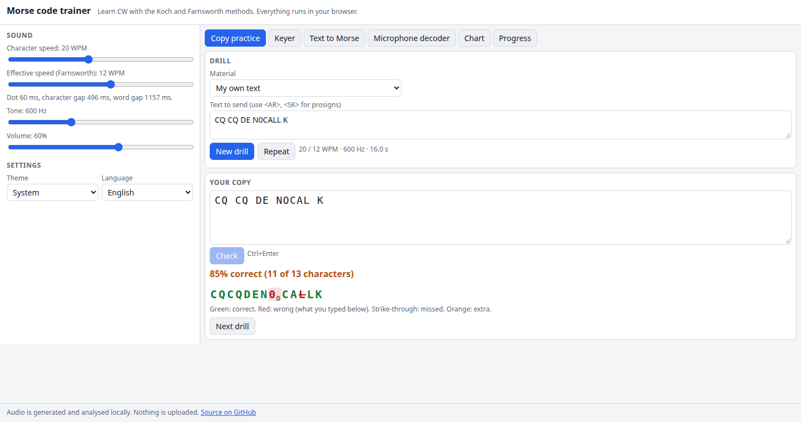

# Morse Code Trainer

Learn Morse code (CW) in the browser. Copy drills use the Koch method with Farnsworth spacing, with scoring that tells you which characters you keep missing. A straight key and an iambic keyer let you practise sending, a player turns any text into Morse, and a microphone decoder reads CW from a speaker or radio. Everything is generated and analysed locally, with Web Audio and no backend.

**Try it: [hermes98761234.github.io/morse-code-trainer](https://hermes98761234.github.io/morse-code-trainer/)**

[](https://github.com/hermes98761234/morse-code-trainer/actions/workflows/deploy.yml)



## Features

- **Koch method.** Start with two characters (K, M) at full character speed and add the next one in the standard LCWO order (K M U R E S N A P T L W I . J Z = F O Y , V G 5 / Q 9 2 H 3 8 B ? 4 7 C 1 D 6 0 X) when you copy 90% correctly. A level-up prompt appears after a long enough, accurate drill.
- **Farnsworth timing.** Character speed and effective speed are separate sliders. Dots and dashes stay fast while the gaps stretch.
- **Drills.** Random character groups, words built only from the characters you know, callsigns, a full CQ / answer / exchange / 73 QSO, or your own text with prosigns such as `<AR>` and `<SK>`.
- **Copy practice with scoring.** Type what you hear. Your copy is aligned against what was sent by edit distance, so one dropped character does not spoil the rest. Missed, wrong and extra characters are marked, and per-character statistics show your weak spots.
- **Keyer.** Straight key (Space or a big touch button) or iambic A/B paddles (arrow keys, Z/X, or touch buttons) with a sidetone. Your keying is decoded live, and you can key a target text and see when it matches.
- **Text to Morse.** Plays any text with the current speed, tone and Farnsworth settings, highlights the character being sent, and downloads a WAV file.
- **Microphone decoder (bonus).** A Goertzel tone detector with adaptive thresholds and speed estimation, a tone finder, and a level meter.
- **Reference chart.** Letters, numbers, punctuation and prosigns. Click any of them to hear it.
- **Progress** is saved in your browser: sessions, accuracy chart, per-character accuracy and the Koch level.
- English and Ukrainian interface, light/dark/system theme, installable PWA metadata. No tracking, and no data leaves your browser.

## How it works

Timing follows PARIS: one dot is 1.2 / WPM seconds, a dash is 3 dots, and the gaps are 1, 3 and 7 dots. For Farnsworth timing with character speed *c* and effective speed *s*, the extra delay per unit is `ta = (60c − 37.2s) / (19cs)` seconds. The gap between characters is `3·ta` and between words `7·ta`, so PARIS at 18/5 WPM takes exactly 12 s.

Playback schedules one oscillator's gain ramps ahead of time on the Web Audio clock, so timing does not depend on JavaScript timers. The keyer is a small state machine (Curtis mode A and B, with paddle memory) that is stepped with explicit time and unit tested. The decoder takes tone and silence runs, estimates the dot length by clustering dot and dash lengths, separates character and word gaps (also with Farnsworth spacing), and drops blips. For audio, the runs come from Goertzel power readings with a decaying peak, a noise floor and hysteresis.

The core logic lives in `src/lib/` as pure functions, with unit tests for the code table, PARIS and Farnsworth timing, scoring, the keyer modes, and decoding of synthesized noisy audio at 8 to 35 WPM.

## Quick start

You need [Node.js](https://nodejs.org/) 22.

```bash
git clone https://github.com/hermes98761234/morse-code-trainer.git
cd morse-code-trainer
npm install
npm run dev       # http://localhost:5173
npm test          # logic and i18n tests
npm run build     # static site in dist/
```

## License

MIT
